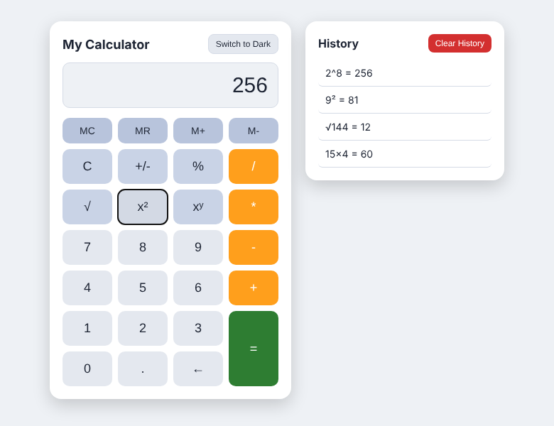
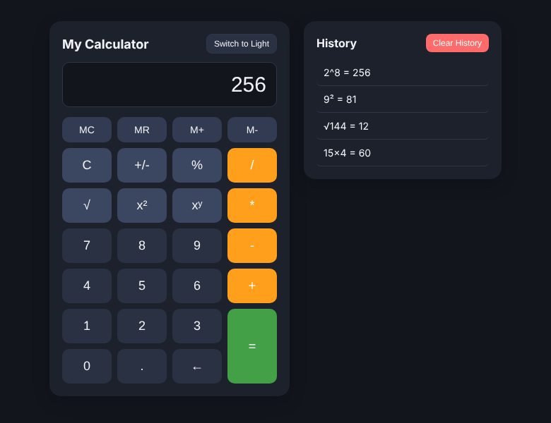
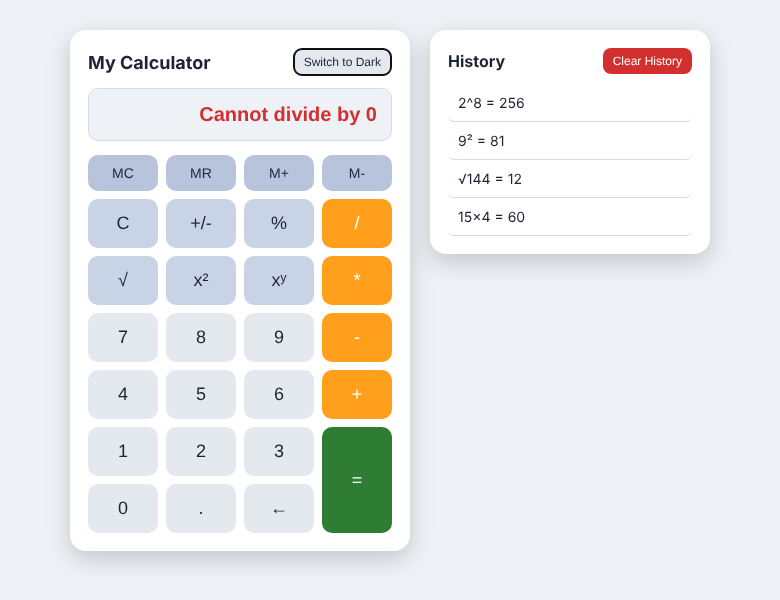

# Advanced Web Calculator

A browser calculator built with HTML, CSS and JavaScript (class `git-calculator` project), extended with scientific functions, friendly error handling, a calculation history log and memory keys.

## Features

- **Standard operators** `+ - * /` with correct precedence, decimal input and backspace
- **Dark / light mode** toggle button
- **Keyboard support**: digits, `+ - * / ^ .`, `Enter` = calculate, `Esc` = clear, `Backspace`, `%`
- **Scientific operations**
  - `%` converts the displayed value to a decimal percentage (50 -> 0.5)
  - `+/-` toggles the sign
  - `√` square root (negative input shows an error)
  - `x²` square and `xʸ` custom power (also `^` on the keyboard)
- **Error handling**: `10 / 0` shows **Cannot divide by 0** (never `Infinity` or `NaN`). The message clears automatically on the next key press.
- **History log** side panel: every completed calculation is recorded (for example `15 × 4 = 60`), click an entry to reload its result into the display, **Clear History** empties the list
- **Bonus - memory**: `MC`, `MR`, `M+`, `M-`

## Run it

Open `index.html` in a browser, or use the VS Code / Antigravity Live Server extension.

## Screenshots

| Light mode + history | Dark mode | Divide by zero |
|---|---|---|
|  |  |  |

## Git workflow used

```bash
git switch main
git pull
git switch -c feature/advanced-calc
# commits: scientific ops, error handling, history panel, memory, README
git switch main
git merge feature/advanced-calc
git push origin main
```
